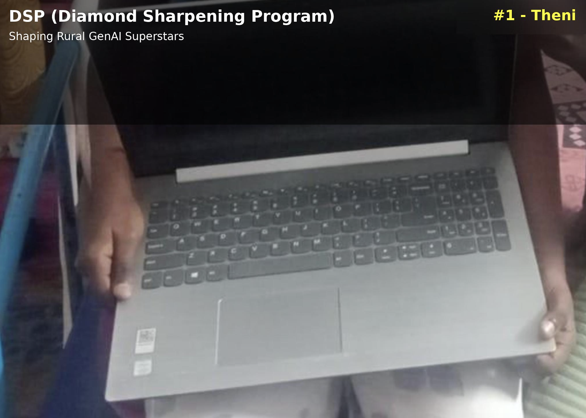

/ [Home](index.md)

## DSP - Diamond Sharpening Program

## Eligibility

- You must have 95+ marks in Science and Maths
- You must be from any Public School or Under-privileged background in South India
- You must be interested in Engineering (GenAI / CSE / AIDS / AIML / IT)
- You must be fluent in writing/speaking any South Indian language (Tamil / Telugu / Kannada / Malayalam)
- You must be willing to learn English quickly

## How do we train you?

- We provide a used laptop during your 11th and 12th grade
- Based on your learning and commitment, we will upgrade your laptop to a used MacBook after 2 years
- We will teach you Linux/Mac after your 12th grade
- We will train you for 6 years

## Fee Structure

- You pay the first 2 months of your salary after you get your first job (after Engineering)

## How to Apply

Email your details to info@kactii.com or Call this Indian Number: +91 959 767 1116

---

## History:

### DSP#2 - P.G.Prasanna

Hometown: Ulundurpet

State: Tamil Nadu, India

We found our second diamond via our DSP: Prasanna 💎

Based in Ulundurpet, Tamil Nadu, India, Prasanna is the recipient of DSP #2. As a gesture of appreciation for his efforts and dreams, we handed over a used MacBook — the second device in the history of the program.

The DSP is built on the idea of a community lifting up its own. We are not looking for the most accomplished or the most credentialed — we are looking for genuine effort and honest dreams, wherever they come from. A used MacBook may seem modest, but its real value is the message behind it: someone sees your effort, believes in your dreams, and wants you to keep going.

Every device in this program is personally funded by Raja CSP Raman through Kactii. This is not a grant, a scholarship, or a contract — it is simply a community gesture, given with no strings attached.

We are proud to welcome Prasanna into the growing DSP family. He is the second of many.

E4E - Education 4 Everyone.

---

### DSP#1 - Sarvadha

Hometown: Chinnamanur

District: Theni

We just discovered our Diamond #1 from Theni 💎

She’s only 13 years old, and already beginning her journey with Lubuntu (Lighter Ubuntu) on a sponsored laptop.

Huge thanks to Packiaraj for identifying this raw talent.

This is exactly why DSP exists —
to find brilliance where the world isn’t looking and give it the tools to shine.

Let’s give back to society. Let’s build the next generation.

--

As a part of our DSP (Diamond Sharpening Program), we discovered Sarvadha from Chinnamanur, Theni District, Tamil Nadu, India. Her father is an auto driver, and despite the humble background, Sarvadha has proven herself to be an exceptionally talented student. She has held the first rank consistently from 4th grade through 8th grade — an incredible streak of 60 months without ever missing the top spot.

A special thanks to our Director Packiaraj for identifying Sarvadha through the DSP program. She proudly became our very first DSP scholar — DSP#1.

We shipped Sarvadha a used Lubuntu OS-based laptop, and she is already learning Lubuntu, Python and GenAI Basics during her vacation. A bright start to a bright future.

Who knows, Sarvadha might end up joining NASA in her future and transforming our earth. 

E4E - Education 4 Everyone.

---

*Note: This program is designed for students from public schools or under-privileged in Tamil Nadu who are interested in STEM / engineering and technology fields.*